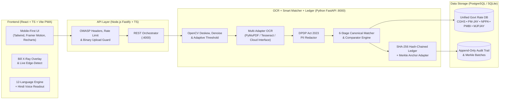

# System Architecture (`ARCHITECTURE.md`)

**Product**: SwasthyaBillCheck (NMBTP: National Medical Bill Transparency Platform)  
**Team**: TechNova — SBI Youth Ideathon 2026  

---

## 1. End-to-End Architecture Flow (Matches Ideathon Deck Slide 4)

---

## 2. The 6-Stage Smart Matching Engine (`services/ai-engine/app/matcher.py`)
1. **Stage 1 — Line Classification**: Classifies raw bill text into `room_rent`, `consultation`, `procedure`, `investigation`, `pharmacy`, `consumable`, `implant`, `package`, or `misc`.
2. **Stage 2 — Multi-Stage Canonicalization**:
   - **Dictionary & Synonym Lookup**: Matches bilingual medical terms and abbreviations (`CBC`, `2D Echo`, `HRCT`, `PTCA`, `कमरे का किराया`, `हार्ट स्टेंट`).
   - **Fuzzy Matching**: Computes character 3-gram Jaccard similarity (`pg_trgm` equivalent) + Levenshtein edit distance ratio.
   - **Vector Embedding Retrieval**: Computes 64-dim character/word n-gram embeddings (`pgvector` compatible) and ranks via cosine similarity.
   - **Constrained Re-Ranker**: Re-ranks strictly within the retrieved database candidates (zero free-text invention). Returns top-3 candidates with confidence; below threshold triggers `needs_confirmation`.
3. **Stage 3 — Strict Comparator Selection by Item Type**:
   - **Itemized Lines (`consultation`, `room_rent`, `investigation`, `procedure`)**: Compares against **CGHS** schedule adjusted for City Tier (`X`=100%, `Y`=90%, `Z`=80%), NABH vs Non-NABH (`-15%`), and Ward Entitlement (`general`, `semi_private`, `private`). **Never** compares a single room-rent or consultation line against a bundled PM-JAY package.
   - **Surgery Bundles (`package`)**: Compares against **CGHS** and **PM-JAY HBP 2.2** packages (plus State **MJPJAY** when applicable), returning both comparators.
   - **Capped Implants (`implant`) & Drugs (`pharmacy`)**: Compares against statutory **NPPA DPCO** ceiling prices + **Jan Aushadhi (PMBI)** generic MRP benchmarks.
4. **Stage 4 — Anomaly & Unbundling Rules**:
   - `DUPLICATE_CHARGE`: Flags identical canonical items billed multiple times.
   - `UNBUNDLED_INCLUDED_IN_ROOM_OR_PACKAGE`: Flags separate nursing, RMO, monitor, or PPE/gloves charges when Room Rent, ICU, or a Surgery Package is already billed.
   - `DAYS_EXCEED_STAY_DURATION`: Flags room rent days exceeding total hospital stay duration.
   - `ARITHMETIC_LINE_TOTAL_ERROR` & `GRAND_TOTAL_ARITHMETIC_MISMATCH`.
5. **Stage 5 & 6 — Multilingual Plain-Language Explanations & Evidence**: Every line outputs status, reference rate, delta in ₹ and %, plain-language explanation (`en` & `hi`), a polite question for the hospital billing desk, and full documentary evidence (`source_id`, `document_version`, `page_ref`, `effective_from`, `source_url`).

---

## 3. Tamper-Evident Audit Ledger (`services/ai-engine/app/ledger.py`)
- Each verification report computes `report_hash = SHA-256(prev_hash + "|" + canonical_json(report_payload))`.
- Periodic Merkle roots (`compute_merkle_root`) are anchored in `merkle_batch` with an optional Ethereum Sepolia / Hyperledger Fabric adapter (`OptionalChainAnchorAdapter`).
- Every PDF report embeds a QR code pointing to `/verify/:hash` for instant public cryptographic verification.

